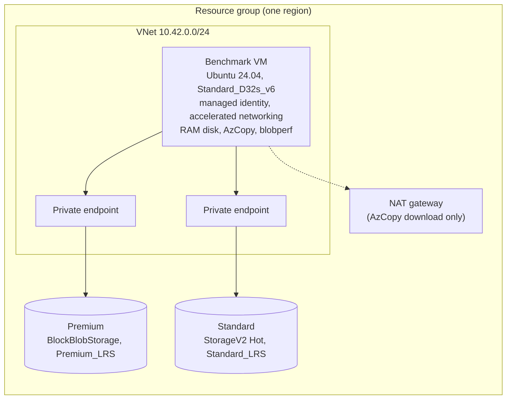

# Azure storage performance demo

Compare Azure Premium and Standard block blob storage, and optionally Azure Managed Lustre, with repeatable tests in
your own subscription and region. The repository deploys a benchmark VM and the storage with Bicep, re-runs the tests
from the Azure blog post
[Premium Block Blob Storage - a new level of performance](https://azure.microsoft.com/en-us/blog/premium-block-blob-storage-a-new-level-of-performance/)
(Claus Joergensen, November 2018), and produces an HTML report that puts your numbers next to the published ones.

> [!NOTE]
> The repository contains no benchmark results. The VM generates all test data randomly, and results stay in your
> subscription and in the git-ignored `results/` folder. Run the demo to get numbers for your region and for today's
> service.

## Why it's useful

Premium block blob storage keeps data on SSDs. It costs more per GB stored than Standard but less per transaction, so
whether it pays off depends on how a workload uses storage. The most-quoted comparison is the 2018 blog post, and the
service has changed a lot since then. This demo gives you current, like-for-like evidence:

- Measure the latency of small random reads, the access pattern of interactive apps, telemetry and messaging
  pipelines, and many AI and analytics data loaders. You get the average and percentiles up to P99.9, timed to the
  first and to the last byte.
- Time bulk uploads and downloads of 100,000 small objects with AzCopy, the way the blog post did, and the time it
  takes to list them.
- Rely on a fair comparison. Both accounts are tested from the same VM, with the same objects and the same access
  pattern, one test at a time.
- Find out whether availability zone placement matters by testing the same storage accounts from one VM per zone.
- Compare object storage with a parallel file system. The Azure Managed Lustre option runs the counterpart of every
  test on the same VMs, adds a large-file bandwidth test and writes its own report.
- Demo it to customers or your team. Deployment takes about 5 minutes, you can run the tests live over SSH, and one
  command deletes everything.
- Trace outliers. Every latency sample is saved with its `x-ms-request-id`, which Azure support can look up.

## What the blog post measured

| Test         | Method                                                                                                    | Published Premium      | Published Standard        |
|--------------|-----------------------------------------------------------------------------------------------------------|-----------------------:|--------------------------:|
| **Latency**  | Read a random selection of 10,000 objects from a population of 1,000,000 64 KB objects; time to last byte | avg 5.3 ms, P99 6.9 ms | avg 61.4 ms, P99 287.3 ms |
| **Upload**   | AzCopy v10, 100,000 64 KB objects from a 100 GB RAM disk on a D32 v3 VM                                   | 20.5 s                 | 107.3 s                   |
| **Download** | AzCopy v10, the same 100,000 objects to the RAM disk                                                      | 24.1 s                 | 118.8 s                   |
| **List**     | List the same 100,000 objects                                                                             | 10.7 s                 | 26.3 s                    |

The demo reproduces each test as closely as possible. [How the tests work](#how-the-tests-work) lists the remaining
differences, and [Azure Managed Lustre](#azure-managed-lustre-optional) describes the file system variant.

## What you get

`./scripts/demo.ps1 download` (or `./scripts/demo.sh download`) saves the latest results under
`./results/<timestamp>/`:

| File                                  | Contents                                                                                                                                                                                                                                                                                                                                                                                                     |
|---------------------------------------|--------------------------------------------------------------------------------------------------------------------------------------------------------------------------------------------------------------------------------------------------------------------------------------------------------------------------------------------------------------------------------------------------------------|
| `report.html`                         | Charts in the style of the blog post, and tables for latency (average, P50, P90, P99, P99.9 and maximum, to the first and to the last byte) and for upload, download and list times, with how many times longer Standard took than Premium. When your test parameters match the blog's, its 2018 numbers appear alongside. An environment table records the region, VM size, network path and tool versions. |
| `summary.md`, `summary.json`          | The same results as Markdown and JSON                                                                                                                                                                                                                                                                                                                                                                        |
| `latency-*.json`, `throughput-*.json` | Raw results of each test                                                                                                                                                                                                                                                                                                                                                                                     |

The VM also keeps every latency sample as CSV in `/var/lib/blobperf/results`. The zone comparison report adds charts
and tables per zone, each zone's best run, the best and worst zone for each metric, and the winner of each latency
round. The Azure Managed Lustre tests write `lustre-report.html`, `lustre-summary.md` and `lustre-summary.json`,
separate from the blob reports.

## What gets deployed



| Resource                 | Notes                                                                                                                                                                                                                                                                                                                                                                        |
|--------------------------|------------------------------------------------------------------------------------------------------------------------------------------------------------------------------------------------------------------------------------------------------------------------------------------------------------------------------------------------------------------------------|
| Premium storage account  | `BlockBlobStorage`, `Premium_LRS` (as in the blog post)                                                                                                                                                                                                                                                                                                                      |
| Standard storage account | `StorageV2`, Hot tier, `Standard_LRS`                                                                                                                                                                                                                                                                                                                                        |
| Benchmark VM             | `Standard_D32s_v6`: 32 vCPU, 128 GiB, 16 Gbps, the same shape as the blog's D32 v3. Ubuntu 24.04, accelerated networking, system-assigned managed identity with *Storage Blob Data Contributor* on both accounts. Optionally one VM per availability zone (`vmZones`).                                                                                                       |
| Network                  | VNet with private endpoints and a `privatelink.blob` private DNS zone (default). Optionally uses a service endpoint instead (see `storageNetworkMode`). A NAT gateway gives the VM outbound internet access to download AzCopy; storage traffic does not go through it. The VNet also holds an empty `snet-lustre` subnet for the optional Azure Managed Lustre file system. |
| Auto-shutdown            | The VMs are deallocated daily at 23:00 UTC.                                                                                                                                                                                                                                                                                                                                  |

Security defaults: the storage accounts accept Microsoft Entra ID (OAuth) only, because shared keys are disabled. Public blob access is
disabled, and the accounts are reachable only from the VM's network. The VM has no public IP and no inbound
access. You drive it with `az vm run-command`, unless you explicitly allow SSH from your own IP.

## Quick start

Prerequisites:

- [Azure CLI](https://learn.microsoft.com/cli/azure/install-azure-cli) with Bicep (`az bicep install`)
- PowerShell 7.2+ (Windows, macOS, Linux) **or** bash
- A subscription where you can create resources and role assignments (Owner, or Contributor + User Access
  Administrator)
- 32 vCPUs of quota for the Dsv6 family in the target region, or a smaller size with `-VmSize`

Clone the repository and sign in to Azure. Then deploy, run the tests, download the report and delete everything:

```bash
git clone https://github.com/stefanatanasiu/azure-storage-perf-demo.git
cd azure-storage-perf-demo
```

```powershell
az login
./scripts/demo.ps1 deploy -Location swedencentral   # ~5 minutes
./scripts/demo.ps1 run                              # ~30-45 minutes: loads 2 x 1,000,000 objects, then runs every test
./scripts/demo.ps1 download                         # summary.md, summary.json and report.html under ./results
./scripts/demo.ps1 destroy                          # delete everything
```

```bash
az login
./scripts/demo.sh deploy --location swedencentral
./scripts/demo.sh run
./scripts/demo.sh download
./scripts/demo.sh destroy
```

The first `run` loads the latency dataset, 1,000,000 × 64 KiB random objects per account. Later runs reuse it,
so `./scripts/demo.ps1 run` (or only `latency` / `throughput`) completes in about 20-30 minutes.

Other commands: `info`, `load`, `latency`, `throughput`, `zones`, `status`, `wait`, `report`, `exec`, `stop`
(deallocate the VMs), `start`. Pass options to the VM-side tool with `-Options` / `--options`, for example
`./scripts/demo.ps1 latency -Options '--reads 2000'` or `./scripts/demo.sh throughput --options "--iterations 1"`.

### Comparing availability zones

A locally redundant storage account lives in one datacenter, so a VM in the same availability zone may see
lower latency than one in another zone. To measure this, deploy one identical VM per zone. All of them use
the same two storage accounts and the same dataset.

```powershell
./scripts/demo.ps1 deploy -Zones 1,2,3      # vm-blobperf-z1, -z2, -z3 (3 x 32 vCPU of quota)
./scripts/demo.ps1 zones                    # ~75 minutes; loads the dataset first if needed
```

```bash
./scripts/demo.sh deploy --zones 1,2,3
./scripts/demo.sh zones
```

`zones` runs a single job at a time and never tests two zones in parallel:

1. Latency: `-Rounds` rounds (default 3). Each round tests every zone once, rotating the starting zone,
   so changes over time don't look like a zone effect.
2. Throughput: `-Iterations` iterations per zone (default 3).
3. Report: the downloaded `report.html` has charts per zone (latency to the last and to the first byte, TCP
   connect time and throughput) and shows each zone's **best run**: the lowest value each metric reached in
   any of that zone's runs. Below the charts, it lists every individual run, the best and worst zone for each
   metric with the difference, and which zone won each latency round. A zone that wins every round has a real
   advantage. Zone labels include the physical zone each logical zone maps to in your subscription
   (`az account list-locations`).

Each test publishes its results to the `results` container of the Standard account, and
`blobperf report --zones` combines them. On an existing single-VM deployment, delete the zone-less VM first:
incremental redeployments keep it, and it holds 32 vCPUs of quota even when deallocated. If the dataset isn't
loaded yet, run `./scripts/demo.ps1 load -Vm vm-blobperf-z1` once before `zones`.

### Live demo over SSH

To show the tests running live, deploy with SSH allowed from your current public IP. This creates a public IP,
and the NSG admits only your address:

```powershell
./scripts/demo.ps1 deploy -Location swedencentral -AllowSshFrom me -SshPublicKeyPath ~/.ssh/id_ed25519.pub
ssh azureuser@<vmPublicIpAddress>
blobperf info
blobperf latency            # watch both accounts being measured
blobperf throughput --iterations 1
blobperf report
```

### Deploying without the scripts

```bash
az deployment sub create --location swedencentral --template-file infra/main.bicep \
  --parameters adminSshPublicKey="$(cat ~/.ssh/id_ed25519.pub)"
az vm run-command invoke -g rg-blobperf-demo -n vm-blobperf --command-id RunShellScript \
  --scripts "/usr/local/bin/blobperf start run-all"
az vm run-command invoke -g rg-blobperf-demo -n vm-blobperf --command-id RunShellScript \
  --scripts "/usr/local/bin/blobperf status"
```

## How the tests work

Everything that measures runs on the VM, in the same region as the storage accounts.
[`vm/blobperf.py`](vm/blobperf.py) uses only the Python standard library, and AzCopy handles the bulk transfers.
Deployment installs both tools; no clone of this repository is needed on the VM.

|                 | Blog post (2018)                              | This repository                                                                                                                                                                                                                                                                                                                                                                                    |
|-----------------|-----------------------------------------------|----------------------------------------------------------------------------------------------------------------------------------------------------------------------------------------------------------------------------------------------------------------------------------------------------------------------------------------------------------------------------------------------------|
| Test data       | Random byte arrays                            | `os.urandom` on the VM. Names such as `3fa9-0012345.bin` use a short hash prefix that spreads objects over the key range ([partitioning guidance](https://learn.microsoft.com/azure/storage/blobs/storage-performance-checklist#partitioning)).                                                                                                                                                    |
| Latency dataset | 1,000,000 × 64 KB                             | 1,000,000 × 64 KiB per account, uploaded with AzCopy in 10 batches of 100,000. Loading can resume.                                                                                                                                                                                                                                                                                                 |
| Latency test    | 10,000 random reads, time to last byte        | 10,000 reads of a seeded random sample (the same objects on both accounts), one request at a time on a keep-alive HTTPS connection, after 50 warm-up reads of other objects. Each read is timed from sending the request to the first byte (the response headers arrive) and to the last byte (the blog's metric); reports show both. TCP connect time (≈ one network round trip) is recorded too. |
| Upload/download | AzCopy v10, 100,000 × 64 KB, RAM disk, D32 v3 | Latest AzCopy v10, managed identity auth, 100,000 × 64 KiB, `tmpfs` RAM disk (also used for AzCopy's job plans and logs), D32s v6. Wall-clock time per job, a new container per run, alternating account order, median of 3 runs.                                                                                                                                                                  |
| List            | List the 100,000 objects                      | List Blobs REST API, 5,000 per page, on the container just uploaded. Entries are counted, not parsed, so client-side XML handling does not add to the time.                                                                                                                                                                                                                                        |
| Network         | Public endpoint, same region                  | Private endpoint (default) or service endpoint, same region                                                                                                                                                                                                                                                                                                                                        |

The report shows the blog's numbers only when the parameters match the blog's, so every comparison is like
for like. Results land on the VM in `/var/lib/blobperf/results`, including a CSV with every latency sample and
its `x-ms-request-id`. `download` fetches `summary.md`, `summary.json`, `report.html` (charts in the style of
the blog post) and the raw result files.

### Things that affect the results

- Storage performance varies by region and over time, and the service has changed a lot since 2018. Treat any
  single run as a sample, and repeat runs to see the spread.
- `run` reads objects minutes after uploading them. To measure older data, run
  `latency` again later, for example the next day (the dataset stays in place while the VM is stopped).
  Right after a bulk load, the accounts can also show transient slowdowns. If a throughput run is an outlier,
  repeat it or use `--iterations 5`. Each AzCopy job records when 50% and 99% of its transfers had finished,
  which tells a slow tail apart from uniformly slower transfers.
- The throughput test uses AzCopy's default concurrency, as the blog post did. To check
  whether the client or the storage account sets the pace, rerun with a higher concurrency, for example
  `./scripts/demo.ps1 throughput -Options '--azcopy-concurrency 2000'`. If throughput stays flat while
  AzCopy's average end-to-end latency rises (`AverageE2EMilliseconds` in the results JSON), extra requests
  are only queueing, and the account is the limit.
- The latency client is deliberately minimal. Time to first byte and time to last
  byte differ by only tens of microseconds for a 64 KiB read, so the service dominates what you measure.
- Real-time antivirus scanning of 100,000 small files can slow AzCopy down. If Microsoft
  Defender for Endpoint is present on the VM, the work folder `/ramdisk/blobperf/` is excluded from scanning
  (`mdeExcludeWorkFolder`). Defender for Cloud can install MDE some time after the VM is created, so every
  test checks again and records the MDE state in its results. Microsoft Defender for Storage on-upload malware scanning would read every uploaded
  blob during the test and cost about $0.15/GB, so it is turned off for the two test accounts only
  (`excludeFromDefenderForStorage`). Both accounts hold random data only.

## Azure Managed Lustre (optional)

The same tests, plus a large-file bandwidth test, can run against an
[Azure Managed Lustre](https://learn.microsoft.com/azure/azure-managed-lustre/amlfs-overview) (AMLFS) file system. The
file system joins an existing deployment: it uses the VNet's `snet-lustre` subnet and the same VMs. Its results go to
a separate report, `lustre-report.html`, and never into the blob report.

> [!WARNING]
> Azure Managed Lustre bills the provisioned capacity for every hour the file system exists, used or not. The
> smallest one, `AMLFS-Durable-Premium-500` with 4 TiB, costs about $2.49 per hour (about $60 per day) in Sweden
> Central. Run `lustre-delete` as soon as the tests are done.

```powershell
./scripts/demo.ps1 deploy -Zones 1,2,3          # once: the VMs and the snet-lustre subnet
./scripts/demo.ps1 lustre-deploy -LustreZone 1   # ~20 minutes: file system + Lustre client on every VM
./scripts/demo.ps1 lustre-zones                  # ~75 minutes: every test, one zone at a time
./scripts/demo.ps1 lustre-delete                 # unmount everywhere, then delete the file system (~10 minutes)
```

```bash
./scripts/demo.sh deploy --zones 1,2,3
./scripts/demo.sh lustre-deploy --lustre-zone 1
./scripts/demo.sh lustre-zones
./scripts/demo.sh lustre-delete
```

With a single VM, use `lustre-run` instead of `lustre-zones`. Other commands: `lustre-info`, `lustre-status`,
`lustre-wait`, `lustre-report`, `lustre-download` and `lustre-exec`, which work like their blob counterparts.

### What lustre-deploy adds

| Resource      | Notes                                                                                                                                                                                                                            |
|---------------|----------------------------------------------------------------------------------------------------------------------------------------------------------------------------------------------------------------------------------|
| File system   | `amlfs-blobperf`: `AMLFS-Durable-Premium-500`, 4 TiB (2,000 MB/s provisioned) in one availability zone (`-LustreZone`). Change it with `-LustreSku` and `-LustreCapacityTiB` (a multiple of the SKU's increment).                |
| Subnet        | `snet-lustre` (10.42.0.128/26), created by `deploy`, with its own NSG holding the documented Lustre and Azure service rules, and the NAT gateway for the file system's outbound traffic.                                         |
| Lustre client | A managed Run Command on each VM installs the Microsoft-built Lustre client from `packages.microsoft.com`, the `lustreperf` tool and its configuration (`/etc/blobperf/lustre.env`). The file system is mounted at `/mnt/amlfs`. |

The Lustre client is a kernel module that must match the VM's kernel exactly. Microsoft signs its prebuilt modules,
so they load with Secure Boot on Trusted Launch VMs, but publishes them for specific kernels only, and these lag the
newest kernel of the Ubuntu marketplace image. When the running kernel has no module, the setup installs a supported
kernel with its module (the LTS kernel line first, as Microsoft recommends), makes it the GRUB default and reboots the
VM. From then on the blob tests run on that kernel too.

### How the Lustre tests work

[`vm/lustreperf.py`](vm/lustreperf.py) runs the counterpart of every blob test on the mounted file system and shares
`blobperf.py`'s helpers. Before each read phase it drops the VM's page cache and cancels the client's cached Lustre
locks, so reads come from the servers rather than from the VM's memory.

|                 | Blob demo                                                                | Lustre                                                                                                                                                                                                                                                                                                                                                                                                                                                    |
|-----------------|--------------------------------------------------------------------------|-----------------------------------------------------------------------------------------------------------------------------------------------------------------------------------------------------------------------------------------------------------------------------------------------------------------------------------------------------------------------------------------------------------------------------------------------------------|
| Latency dataset | 1,000,000 × 64 KiB objects                                               | 1,000,000 × 64 KiB random files in one directory, with the same names                                                                                                                                                                                                                                                                                                                                                                                     |
| Latency test    | 10,000 random reads, one at a time, timed to the first and the last byte | Two passes over different random files, one read at a time, cold cache. Whole-file reads (10,000): `open()` and one read of the whole file, timed to the open (a metadata server round trip) and to the last byte; the difference is the data request to the storage server ("read after open"). First-byte reads (10,000 other files): `open()` and a read of the first 4 KiB only. A separate pass keeps the whole-file reads at one data request each. |
| Upload / write  | AzCopy from the RAM disk                                                 | Copy 100,000 × 64 KiB files from the RAM disk with 64 operations in flight, then `syncfs` until the servers hold all the data                                                                                                                                                                                                                                                                                                                             |
| Download / read | AzCopy to the RAM disk                                                   | Copy the same files back to the RAM disk, cold cache                                                                                                                                                                                                                                                                                                                                                                                                      |
| List            | List Blobs                                                               | Names only (`readdir`), and names with attributes (`readdir` and `stat`, like `ls -l`), the closer match to List Blobs                                                                                                                                                                                                                                                                                                                                    |
| Delete          | Not timed                                                                | Parallel `unlink` of the 100,000 files                                                                                                                                                                                                                                                                                                                                                                                                                    |
| Large files     | No test                                                                  | 16 streams × 4 GiB with 4 MiB I/O, striped over every storage target: write with `fsync`, then read with a cold cache. Reported in MB/s next to the provisioned bandwidth.                                                                                                                                                                                                                                                                                |

`lustre-zones` follows `zones`. It loads the dataset once from the VM in the file system's zone. Then it runs
`-Rounds` latency rounds that rotate the zone order, and `-Iterations` small-file and large-file runs per zone
(default 3 each), never two VMs at once. The report shows each zone's best run, the best and worst zone per metric
with the round winners, and every individual run. The file system's zone is labelled `AMLFS`.

### Things that affect the Lustre results

- The file system lives in one availability zone. From a VM in another zone, every request crosses zones, and a cold
  64 KiB read needs several round trips (open, lock, read, close), so expect a larger zone effect than with blob
  storage.
- Creating small files from one VM is limited by metadata server round trips, not by bandwidth: more operations in
  flight than the client allows only queue up. The Azure Managed Lustre client already raises Lustre's defaults
  (for example 128 metadata requests in flight, 32 of them modifying); the report lists the client settings, and
  `--workers` changes the tool's concurrency.
- A Standard_D32s_v6 VM has 16 Gbps (2,000 MB/s) of network bandwidth, the same as the smallest file system's
  provisioned throughput, so the large-file test measures whichever limit is lower. Use a larger VM or file system to
  separate the two.
- The servers don't answer ICMP ping, and with Secure Boot the kernel's lockdown hides Lustre's debug statistics
  (request round trips per server). The report therefore uses `open()` as the metadata server round trip and "read
  after open" as the storage server's, and shows request statistics only where the kernel allows them.
- Microsoft Defender for Endpoint, if present, gets an exclusion for `/mnt/amlfs/` (`mdeExcludeMount` in
  [`infra/lustre.bicep`](infra/lustre.bicep)), like the RAM-disk work folder.

## Parameters

[`infra/main.bicep`](infra/main.bicep) parameters (the scripts expose the common ones):

| Parameter                       | Default                         | Description                                                                                                                                                                  |
|---------------------------------|---------------------------------|------------------------------------------------------------------------------------------------------------------------------------------------------------------------------|
| `location`                      | deployment location             | Region for everything                                                                                                                                                        |
| `resourceGroupName`             | `rg-blobperf-demo`              | Resource group to create                                                                                                                                                     |
| `namePrefix`                    | `blobperf`                      | Prefix for resource names (3-10 lowercase letters/digits)                                                                                                                    |
| `vmSize`                        | `Standard_D32s_v6`              | Benchmark VM size                                                                                                                                                            |
| `vmZones`                       | `[]`                            | Empty: one VM without a zone (`vm-blobperf`). `['1','2','3']`: one VM per zone (`vm-blobperf-z1` ...) for `zones`                                                            |
| `adminSshPublicKey`             | (required)                      | The scripts use `~/.ssh/id_ed25519.pub` / `id_rsa.pub`, or a throwaway key                                                                                                   |
| `sshSourceAddressPrefix`        | empty                           | CIDR allowed to SSH in. Empty means no public IP and no inbound access.                                                                                                      |
| `storageNetworkMode`            | `PrivateEndpoint`               | `PrivateEndpoint` works even where policy disables public network access on storage. `ServiceEndpoint` uses the public endpoint over the Azure backbone, like the 2018 test. |
| `premiumSkuName`                | `Premium_LRS`                   | or `Premium_ZRS`                                                                                                                                                             |
| `standardSkuName`               | `Standard_LRS`                  | or `Standard_ZRS`                                                                                                                                                            |
| `excludeFromDefenderForStorage` | `true`                          | Turn Defender for Storage off on the two test accounts                                                                                                                       |
| `mdeExcludeWorkFolder`          | `true`                          | Exclude the RAM-disk work folder from Defender for Endpoint scanning, if installed                                                                                           |
| `autoShutdownTimeUtc`           | `2300`                          | Daily VM auto-shutdown (UTC, `HHmm`). Empty disables it.                                                                                                                     |
| `tags`                          | `{ workload: 'blobperf-demo' }` | Tags for every resource                                                                                                                                                      |

Redeployments are incremental, so ARM never deletes resources a parameter no longer needs. Switching an
existing deployment from `PrivateEndpoint` to `ServiceEndpoint` leaves the private endpoints and DNS zone in
place, and traffic keeps using them. Delete them first, or `destroy` and deploy again. The report always shows
which path was measured (`private endpoint` or `public endpoint`). Likewise, setting
`excludeFromDefenderForStorage` back to `false` doesn't remove an existing override. Re-enable Defender for
Storage on the accounts in the portal.

`blobperf` on the VM (`blobperf --help`): `info`, `load`, `latency`, `throughput`, `list`, `run-all`,
`report`, `start`, `status`, `export`, `cleanup`. Useful options: `--reads`, `--threads`, `--seed`,
`--objects`, `--files`, `--iterations`, `--size`, `--azcopy-concurrency`, `--targets premium,standard`.

[`infra/lustre.bicep`](infra/lustre.bicep) parameters (deploy it into the resource group of `main.bicep`):

| Parameter                                         | Default                     | Description                                                                                            |
|---------------------------------------------------|-----------------------------|--------------------------------------------------------------------------------------------------------|
| `vmNames`                                         | (required)                  | VMs that get the Lustre client; they must be running. The scripts pass every VM in the resource group. |
| `skuName`                                         | `AMLFS-Durable-Premium-500` | Also `-40`, `-125` or `-250`: provisioned MB/s per TiB of capacity                                     |
| `storageCapacityTiB`                              | `4`                         | A multiple of the SKU's increment: Premium-500 4, Premium-250 8, Premium-125 16, Premium-40 48         |
| `zone`                                            | `1`                         | Availability zone of the file system                                                                   |
| `maintenanceDayOfWeek`, `maintenanceTimeOfDayUtc` | `Sunday`, `03:00`           | Weekly 30-minute maintenance window                                                                    |
| `mdeExcludeMount`                                 | `true`                      | Exclude `/mnt/amlfs/` from Defender for Endpoint scanning, if installed                                |
| `namePrefix`, `location`, `tags`                  | as `main.bicep`             | Must match the base deployment                                                                         |

`lustreperf` on the VM (`lustreperf --help`): `info`, `mount`, `umount`, `load`, `latency`, `throughput`,
`bandwidth`, `run-all`, `report`, `start`, `status`, `export`, `cleanup`. Useful options: `--reads`, `--first-read`,
`--threads`, `--files`, `--workers`, `--iterations`, `--streams`, `--file-size`.

## Cost

These are list prices in Sweden Central at the time of writing; check the
[pricing calculator](https://azure.microsoft.com/pricing/calculator/) for your region.

| Item                                                                | Approximate cost                                 |
|---------------------------------------------------------------------|--------------------------------------------------|
| VM `Standard_D32s_v6` (Linux)                                       | $1.71 per hour per VM while running              |
| Premium storage, ~65 GB dataset                                     | $0.15 per GB-month, about $0.33 per day          |
| Write operations for one full run (~1.3 M per account)              | about $2.60 Premium + $6.50 Standard             |
| Private endpoints, NAT gateway, standard storage                    | cents per hour                                   |
| Azure Managed Lustre, `AMLFS-Durable-Premium-500`, 4 TiB (optional) | $2.49 per hour, about $60 per day, until deleted |

One full run costs roughly **$15-20** if you delete everything afterwards. A zone comparison (three VMs for
about 75 minutes, 900,000 extra writes per account) adds roughly $10-15. A Lustre zone comparison keeps the file
system and three VMs running for about two hours including setup and deletion, roughly $15-20. Use `stop` to
deallocate the VMs between sessions; the dataset stays in place. Use `destroy` when you're done.

## Troubleshooting

| Symptom                                                                | Cause and fix                                                                                                                                                                                                                                                                                |
|------------------------------------------------------------------------|----------------------------------------------------------------------------------------------------------------------------------------------------------------------------------------------------------------------------------------------------------------------------------------------|
| `HTTP 403 AuthorizationPermissionMismatch`                             | The VM's role assignment hasn't propagated yet. The tests wait for up to 15 minutes.                                                                                                                                                                                                         |
| `HTTP 403 AuthorizationFailure`                                        | The storage firewall rejects the VM's network. New private endpoints can take a few minutes. In `ServiceEndpoint` mode, a policy may have disabled public network access on the accounts (check the activity log for `policies/modify/action`); redeploy with the default `PrivateEndpoint`. |
| `SkuNotAvailable` or quota errors                                      | Pick another size or region, for example `-VmSize Standard_D32s_v5`.                                                                                                                                                                                                                         |
| `Changing property 'linuxConfiguration.ssh.publicKeys' is not allowed` | Use the scripts: they reuse the existing VM's key when you redeploy.                                                                                                                                                                                                                         |
| A job seems stuck                                                      | Check `./scripts/demo.ps1 status` and the full log in `/var/log/blobperf/` on the VM. `blobperf cleanup` removes leftover `tp-*` containers.                                                                                                                                                 |
| `mount failed: ... no Lustre client module for the running kernel`     | The VM booted a kernel without a Lustre module, for example after a manual kernel change. Run `lustre-deploy` again: the setup installs a supported kernel and reboots.                                                                                                                      |
| `lustre-deploy` waits a long time at "Starting VM(s)"                  | A VM extension (often Defender for Endpoint after a kernel change) is still configuring; VM operations queue behind it. It finishes on its own.                                                                                                                                              |
| `lustre-deploy` fails with a capacity or quota error                   | Try another zone (`-LustreZone`) or region, or request Azure Managed Lustre quota.                                                                                                                                                                                                           |

`az vm run-command` returns only about 4 KB of output per call. That is why `download` fetches the report in
checksummed chunks.

## Repository layout

```text
infra/
  main.bicep               subscription-scope entry point (resource group + modules)
  main.bicepparam          example parameters for a manual deployment
  lustre.bicep             optional Azure Managed Lustre file system + Lustre client setup (resource group scope)
  modules/
    network.bicep          VNet, subnets, NSGs, NAT gateway, private DNS zone
    storage.bicep          one storage account + container, private endpoint, RBAC, Defender setting
    vm.bicep               benchmark VM, NIC, optional public IP, auto-shutdown
    vm-setup.bicep         managed Run Command that installs vm/ on each VM
    lustre-setup.bicep     managed Run Command that installs the Lustre client and lustreperf on each VM
vm/
  blobperf.py              the benchmark tool (Python standard library only)
  install.sh               VM bootstrap: config, tool, RAM disk, AzCopy
  lustreperf.py            the Lustre benchmark tool (uses blobperf.py's helpers)
  lustre-install.sh        Lustre client (with a supported kernel), config and lustreperf
scripts/
  demo.ps1                 deploy / run / download / destroy, and the lustre-* commands (PowerShell 7)
  demo.sh                  the same for bash
```

## Contributing

Issues and pull requests are welcome. The checks in [`.github/workflows/validate.yml`](.github/workflows/validate.yml)
(Bicep build and lint, Python, ShellCheck and PowerShell parsing) run on every push and pull request.

## Disclaimer

This is a community demo, not an official Microsoft benchmark. Results depend on region, time, VM size and
service versions. Always validate performance with your own workload. Running the demo creates billable resources
in your Azure subscription (see [Cost](#cost)).

## License

[MIT](LICENSE)
