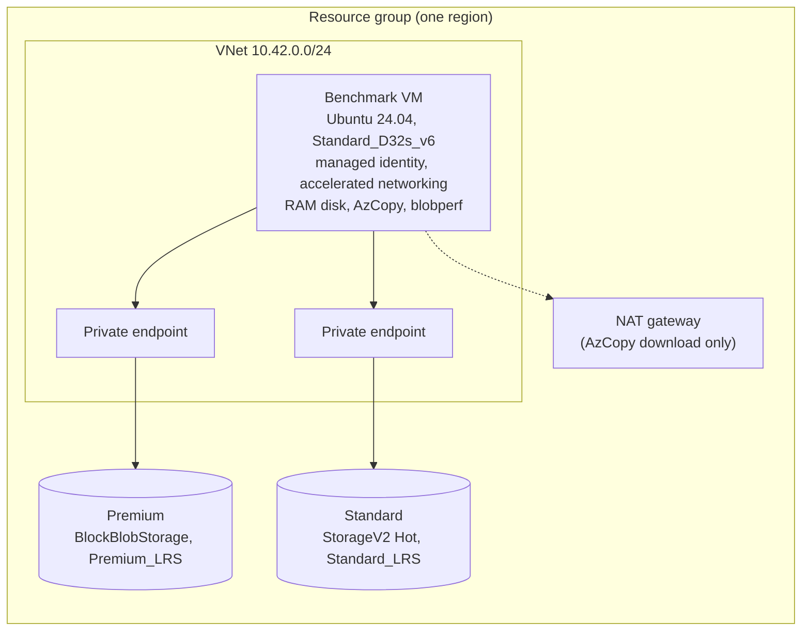

# Azure Premium vs Standard block blob storage: performance demo

Re-run the tests from the Azure blog post
[Premium Block Blob Storage – a new level of performance](https://azure.microsoft.com/en-us/blog/premium-block-blob-storage-a-new-level-of-performance/)
(Claus Joergensen, November 2018) in your own subscription. The repository holds infrastructure as code
(Bicep) and scripts. All test data is generated randomly on the test VM, so the repository contains no data
or results.

## What the blog post measured

| Test | Method | Published Premium | Published Standard |
|---|---|---:|---:|
| **Latency** | Read a random selection of 10,000 objects from a population of 1,000,000 64 KB objects; time to last byte | avg 5.3 ms, P99 6.9 ms | avg 61.4 ms, P99 287.3 ms |
| **Upload** | AzCopy v10, 100,000 64 KB objects from a 100 GB RAM disk on a D32 v3 VM | 20.5 s | 107.3 s |
| **Download** | AzCopy v10, the same 100,000 objects to the RAM disk | 24.1 s | 118.8 s |
| **List** | List the same 100,000 objects | 10.7 s | 26.3 s |

This repository reproduces each test as closely as possible and reports your numbers next to the published ones.

## What gets deployed



| Resource | Notes |
|---|---|
| Premium storage account | `BlockBlobStorage`, `Premium_LRS` (as in the blog post) |
| Standard storage account | `StorageV2`, Hot tier, `Standard_LRS` |
| Benchmark VM | `Standard_D32s_v6`: 32 vCPU, 128 GiB, 16 Gbps, the same shape as the blog's D32 v3. Ubuntu 24.04, accelerated networking, system-assigned managed identity with *Storage Blob Data Contributor* on both accounts. Optionally one VM per availability zone (`vmZones`). |
| Network | VNet with private endpoints and a `privatelink.blob` private DNS zone (default). Optionally uses a service endpoint instead (see `storageNetworkMode`). A NAT gateway gives the VM outbound internet access to download AzCopy; storage traffic does not go through it. |
| Auto-shutdown | The VMs are deallocated daily at 23:00 UTC. |

Security defaults: the storage accounts accept Microsoft Entra ID (OAuth) only, because shared keys are disabled. Public blob access is
disabled, and the accounts are reachable only from the VM's network. The VM has no public IP and no inbound
access. You drive it with `az vm run-command`, unless you explicitly allow SSH from your own IP.

## Quick start

Prerequisites:

- [Azure CLI](https://learn.microsoft.com/cli/azure/install-azure-cli) with Bicep (`az bicep install`).
- PowerShell 7.2+ (Windows, macOS, Linux) **or** bash.
- A subscription where you can create resources and role assignments (Owner, or Contributor + User Access
  Administrator).
- 32 vCPUs of quota for the Dsv6 family in the target region. Otherwise, use `-VmSize`.

```powershell
az login
./scripts/demo.ps1 deploy -Location swedencentral   # ~5 minutes
./scripts/demo.ps1 run                              # ~30-45 minutes: loads 2 x 1,000,000 objects, then runs every test
./scripts/demo.ps1 download                         # summary.md, summary.json and report.html under ./results
./scripts/demo.ps1 destroy                          # delete everything
```

```bash
az login
./scripts/demo.sh deploy --location swedencentral
./scripts/demo.sh run
./scripts/demo.sh download
./scripts/demo.sh destroy
```

The first `run` loads the latency dataset, 1,000,000 × 64 KiB random objects per account. Later runs reuse it,
so `./scripts/demo.ps1 run` (or just `latency` / `throughput`) completes in about 20–30 minutes.

Other commands: `info`, `load`, `latency`, `throughput`, `zones`, `status`, `wait`, `report`, `exec`, `stop`
(deallocate the VMs), `start`. Pass options to the VM-side tool with `-Options` / `--options`, for example
`./scripts/demo.ps1 latency -Options '--reads 2000'` or `./scripts/demo.sh throughput --options "--iterations 1"`.

### Comparing availability zones

A locally redundant storage account lives in one datacenter, so a VM in the same availability zone may see
lower latency than one in another zone. To measure this, deploy one identical VM per zone. All of them use
the same two storage accounts and the same dataset.

```powershell
./scripts/demo.ps1 deploy -Zones 1,2,3      # vm-blobperf-z1, -z2, -z3 (3 x 32 vCPU of quota)
./scripts/demo.ps1 zones                    # ~75 minutes; loads the dataset first if needed
```

```bash
./scripts/demo.sh deploy --zones 1,2,3
./scripts/demo.sh zones
```

`zones` runs a single job at a time and never tests two zones in parallel:

1. Latency: `-Rounds` rounds (default 3). Each round tests every zone once, rotating the starting zone,
   so changes over time don't look like a zone effect.
2. Throughput: `-Iterations` iterations per zone (default 3).
3. Report: the downloaded `report.html` has charts per zone (latency to the last and to the first byte, TCP
   connect time and throughput) and shows each zone's **best run**: the lowest value each metric reached in
   any of that zone's runs. Below the charts, it lists every individual run, the best and worst zone for each
   metric with the difference, and which zone won each latency round. A zone that wins every round has a real
   advantage. Zone labels include the physical zone each logical zone maps to in your subscription
   (`az account list-locations`).

Each test publishes its results to the `results` container of the Standard account, and
`blobperf report --zones` combines them. On an existing single-VM deployment, delete the zone-less VM first:
incremental redeployments keep it, and it holds 32 vCPUs of quota even when deallocated. If the dataset isn't
loaded yet, run `./scripts/demo.ps1 load -Vm vm-blobperf-z1` once before `zones`.

### Live demo over SSH

To show the tests running live, deploy with SSH allowed from your current public IP. This creates a public IP,
and the NSG admits only your address:

```powershell
./scripts/demo.ps1 deploy -Location swedencentral -AllowSshFrom me -SshPublicKeyPath ~/.ssh/id_ed25519.pub
ssh azureuser@<vmPublicIpAddress>
blobperf info
blobperf latency            # watch both accounts being measured
blobperf throughput --iterations 1
blobperf report
```

### Deploying without the scripts

```bash
az deployment sub create --location swedencentral --template-file infra/main.bicep \
  --parameters adminSshPublicKey="$(cat ~/.ssh/id_ed25519.pub)"
az vm run-command invoke -g rg-blobperf-demo -n vm-blobperf --command-id RunShellScript \
  --scripts "/usr/local/bin/blobperf start run-all"
az vm run-command invoke -g rg-blobperf-demo -n vm-blobperf --command-id RunShellScript \
  --scripts "/usr/local/bin/blobperf status"
```

## How the tests work

Everything that measures runs on the VM, in the same region as the storage accounts.
[`vm/blobperf.py`](vm/blobperf.py) uses only the Python standard library, and AzCopy handles the bulk transfers.
Deployment installs both tools; no clone of this repository is needed on the VM.

| | Blog post (2018) | This repository |
|---|---|---|
| Test data | Random byte arrays | `os.urandom` on the VM. Names such as `3fa9-0012345.bin` use a short hash prefix that spreads objects over the key range ([partitioning guidance](https://learn.microsoft.com/azure/storage/blobs/storage-performance-checklist#partitioning)). |
| Latency dataset | 1,000,000 × 64 KB | 1,000,000 × 64 KiB per account, uploaded with AzCopy in 10 batches of 100,000. Loading can resume. |
| Latency test | 10,000 random reads, time to last byte | 10,000 reads of a seeded random sample (the same objects on both accounts), one request at a time on a keep-alive HTTPS connection, after 50 warm-up reads of other objects. Each read is timed from sending the request to the first byte (the response headers arrive) and to the last byte (the blog's metric); reports show both. TCP connect time (≈ one network round trip) is recorded too. |
| Upload/download | AzCopy v10, 100,000 × 64 KB, RAM disk, D32 v3 | Latest AzCopy v10, managed identity auth, 100,000 × 64 KiB, `tmpfs` RAM disk (also used for AzCopy's job plans and logs), D32s v6. Wall-clock time per job, a new container per run, alternating account order, median of 3 runs. |
| List | List the 100,000 objects | List Blobs REST API, 5,000 per page, on the container just uploaded. Entries are counted, not parsed, so client-side XML handling does not add to the time. |
| Network | Public endpoint, same region | Private endpoint (default) or service endpoint, same region |

The report shows the blog's numbers only when the parameters match the blog's, so every comparison is like
for like. Results land on the VM in `/var/lib/blobperf/results`, including a CSV with every latency sample and
its `x-ms-request-id`. `download` fetches `summary.md`, `summary.json`, `report.html` (charts in the style of
the blog post) and the raw result files.

### Things that affect the results

- **Time and place.** Storage performance varies by region and over time, and the service has changed a lot
  since 2018. Treat any single run as a sample, and repeat runs to see the spread.
- **Fresh vs. aged data.** `run` reads objects minutes after uploading them. To measure older data, run
  `latency` again later, for example the next day (the dataset stays in place while the VM is stopped).
  Right after a bulk load, the accounts can also show transient slowdowns. If a throughput run is an outlier,
  repeat it or use `--iterations 5`. Each AzCopy job records when 50% and 99% of its transfers had finished,
  which tells a slow tail apart from uniformly slower transfers.
- **AzCopy settings.** The throughput test uses AzCopy's default concurrency, as the blog post did. To check
  whether the client or the storage account sets the pace, rerun with a higher concurrency, for example
  `./scripts/demo.ps1 throughput -Options '--azcopy-concurrency 2000'`. If throughput stays flat while
  AzCopy's average end-to-end latency rises (`AverageE2EMilliseconds` in the results JSON), extra requests
  are only queueing, and the account is the limit.
- **Client overhead.** The latency client stays deliberately minimal. Time to first byte and time to last
  byte differ by only tens of microseconds for a 64 KiB read, so the service dominates what you measure.
- **Security agents.** Real-time antivirus scanning of 100,000 small files can slow AzCopy down. If Microsoft
  Defender for Endpoint is present on the VM, the work folder `/ramdisk/blobperf/` is excluded from scanning
  (`mdeExcludeWorkFolder`). Defender for Cloud can install MDE some time after the VM is created, so every
  test checks again and records the MDE state in its results. Microsoft Defender for Storage on-upload malware scanning would read every uploaded
  blob during the test and cost about $0.15/GB, so it is turned off for the two test accounts only
  (`excludeFromDefenderForStorage`). Both accounts hold random data only.

## Parameters

[`infra/main.bicep`](infra/main.bicep) parameters (the scripts expose the common ones):

| Parameter | Default | Description |
|---|---|---|
| `location` | deployment location | Region for everything |
| `resourceGroupName` | `rg-blobperf-demo` | Resource group to create |
| `namePrefix` | `blobperf` | Prefix for resource names (3-10 lowercase letters/digits) |
| `vmSize` | `Standard_D32s_v6` | Benchmark VM size |
| `vmZones` | `[]` | Empty: one VM without a zone (`vm-blobperf`). `['1','2','3']`: one VM per zone (`vm-blobperf-z1` ...) for `zones` |
| `adminSshPublicKey` | (required) | The scripts use `~/.ssh/id_ed25519.pub` / `id_rsa.pub`, or a throwaway key |
| `sshSourceAddressPrefix` | empty | CIDR allowed to SSH in. Empty means no public IP and no inbound access. |
| `storageNetworkMode` | `PrivateEndpoint` | `PrivateEndpoint` works even where policy disables public network access on storage. `ServiceEndpoint` uses the public endpoint over the Azure backbone, like the 2018 test. |
| `premiumSkuName` | `Premium_LRS` | or `Premium_ZRS` |
| `standardSkuName` | `Standard_LRS` | or `Standard_ZRS` |
| `excludeFromDefenderForStorage` | `true` | Turn Defender for Storage off on the two test accounts |
| `mdeExcludeWorkFolder` | `true` | Exclude the RAM-disk work folder from Defender for Endpoint scanning, if installed |
| `autoShutdownTimeUtc` | `2300` | Daily VM auto-shutdown (UTC, `HHmm`). Empty disables it. |
| `tags` | `{ workload: 'blobperf-demo' }` | Tags for every resource |

Redeployments are incremental, so ARM never deletes resources a parameter no longer needs. Switching an
existing deployment from `PrivateEndpoint` to `ServiceEndpoint` leaves the private endpoints and DNS zone in
place, and traffic keeps using them. Delete them first, or `destroy` and deploy again. The report always shows
which path was measured (`private endpoint` or `public endpoint`). Likewise, setting
`excludeFromDefenderForStorage` back to `false` doesn't remove an existing override. Re-enable Defender for
Storage on the accounts in the portal.

`blobperf` on the VM (`blobperf --help`): `info`, `load`, `latency`, `throughput`, `list`, `run-all`,
`report`, `start`, `status`, `export`, `cleanup`. Useful options: `--reads`, `--threads`, `--seed`,
`--objects`, `--files`, `--iterations`, `--size`, `--azcopy-concurrency`, `--targets premium,standard`.

## Cost

These are list prices in Sweden Central at the time of writing; check the
[pricing calculator](https://azure.microsoft.com/pricing/calculator/) for your region.

| Item | Approximate cost |
|---|---|
| VM `Standard_D32s_v6` (Linux) | $1.71 per hour per VM while running |
| Premium storage, ~65 GB dataset | $0.15 per GB-month, about $0.33 per day |
| Write operations for one full run (~1.3 M per account) | about $2.60 Premium + $6.50 Standard |
| Private endpoints, NAT gateway, standard storage | cents per hour |

One full run costs roughly **$15–20** if you delete everything afterwards. A zone comparison (three VMs for
about 75 minutes, 900,000 extra writes per account) adds roughly $10–15. Use `stop` to deallocate the VMs
between sessions; the dataset stays in place. Use `destroy` when you're done.

## Troubleshooting

| Symptom | Cause and fix |
|---|---|
| `HTTP 403 AuthorizationPermissionMismatch` | The VM's role assignment hasn't propagated yet. The tests wait for up to 15 minutes. |
| `HTTP 403 AuthorizationFailure` | The storage firewall rejects the VM's network. New private endpoints can take a few minutes. In `ServiceEndpoint` mode, a policy may have disabled public network access on the accounts (check the activity log for `policies/modify/action`); redeploy with the default `PrivateEndpoint`. |
| `SkuNotAvailable` or quota errors | Pick another size or region, for example `-VmSize Standard_D32s_v5`. |
| `Changing property 'linuxConfiguration.ssh.publicKeys' is not allowed` | Use the scripts: they reuse the existing VM's key when you redeploy. |
| A job seems stuck | Check `./scripts/demo.ps1 status` and the full log in `/var/log/blobperf/` on the VM. `blobperf cleanup` removes leftover `tp-*` containers. |

`az vm run-command` returns only about 4 KB of output per call. That is why `download` fetches the report in
checksummed chunks.

## Repository layout

```text
infra/
  main.bicep               subscription-scope entry point (resource group + modules)
  main.bicepparam          example parameters for a manual deployment
  modules/
    network.bicep          VNet, subnets, NSG, NAT gateway, private DNS zone
    storage.bicep          one storage account + container, private endpoint, RBAC, Defender setting
    vm.bicep               benchmark VM, NIC, optional public IP, auto-shutdown
    vm-setup.bicep         managed Run Command that installs vm/ on each VM
vm/
  blobperf.py              the benchmark tool (Python standard library only)
  install.sh               VM bootstrap: config, tool, RAM disk, AzCopy
scripts/
  demo.ps1                 deploy / run / download / destroy (PowerShell 7)
  demo.sh                  the same for bash
```

## Disclaimer

This is a community demo, not an official Microsoft benchmark. Results depend on region, time, VM size and
service versions. Always validate performance with your own workload.

## License

[MIT](LICENSE)
